# PRD — Sistem Analisis Sentimen Ulasan *Arknights: Endfield* (Google Play Store) dengan Multinomial Naïve Bayes

| | |
|---|---|
| **Versi** | 1.0 (draft untuk dikonfirmasi) |
| **Tanggal** | 21 September 2026 |
| **Sumber tunggal** | Draft TA PART 3 — *Analisis Sentimen Ulasan Game Arknights: Endfield pada Playstore dengan Metode Naïve Bayes* (Bab I–III; belum ada Bab IV–V, jadi **belum ada hasil eksperimen**) |
| **Stack (dari proposal)** | Python 3.10.17 · Pandas · NumPy · scikit-learn · NLTK · Sastrawi · Flask · HTML/CSS/Bootstrap/JavaScript |

**Cara membaca dokumen ini.** Setiap aturan punya ID (BL = business logic, FR = fungsional, NFR = non-fungsional) dan satu tag sumber:

- **[DOC]** — tertulis langsung di proposal.
- **[ASUMSI]** — proposal diam atau ambigu, PRD memilih nilai default (semua dirangkum di §13 agar mudah dikonfirmasi).
- **[REKOMENDASI]** — sengaja berbeda dari teks proposal demi kebenaran metodologis; alasannya ditulis di tempat.

Prinsip utama: **sistem harus sama dengan yang dijanjikan proposal**. Jika ada konflik di dalam proposal sendiri, konflik itu dicatat (Lampiran A), bukan diam-diam dipilih.

---

## 1. Ringkasan produk

### 1.1 Apa yang dibangun

Dua komponen yang saling terhubung:

- **A. Pipeline ML (offline):** scraping ulasan Play Store → seleksi → labeling manual → pra-pemrosesan → TF-IDF → Multinomial Naïve Bayes → validasi K-Fold → evaluasi → artefak hasil.
- **B. Aplikasi web (Flask):** dashboard yang menampilkan hasil analisis sentimen (positif/negatif), *sentiment score*, confusion matrix, dan metrik evaluasi model.

### 1.2 Masalah dan tujuan

Ulasan game di Play Store terlalu banyak untuk dianalisis manual. Proposal menargetkan klasifikasi otomatis **biner (positif / negatif)** atas ulasan Arknights: Endfield.

| Rumusan masalah / tujuan proposal | Diterjemahkan menjadi |
|---|---|
| (a) Implementasi Naïve Bayes + TF-IDF untuk menganalisis sentimen ulasan, dalam aplikasi berbasis web | Pipeline A + halaman **Analisis Sentimen** (FR-W01–W03) |
| (b) Performa model (akurasi, presisi, recall, F1) **dalam aplikasi berbasis web** | Halaman **Visualisasi** memuat confusion matrix **dan** panel metrik (FR-W04–W07). Mock proposal hanya menampilkan confusion matrix, tetapi rumusan (b) mewajibkan metrik tampil di web. |

### 1.3 Kriteria sukses

| ID | Kriteria |
|---|---|
| SC-1 | Pipeline dapat dijalankan ulang dengan seed yang sama dan menghasilkan metrik identik. |
| SC-2 | Seluruh 12 kombinasi (6 nilai α × 2 nilai K) dievaluasi dan tersimpan. |
| SC-3 | Angka di web sama persis dengan artefak (selisih 0). |
| SC-4 | Invarian lolos: Σ sel confusion matrix = N; N_positif + N_negatif = N. |
| SC-5 | Semua requirement prioritas *Must* lulus acceptance criteria (§11). |
| SC-6 | Tidak ada angka akurasi yang di-hardcode atau "ditargetkan". Proposal tidak menetapkan target; semua angka berasal dari run nyata. |

### 1.4 Non-goals (di luar proposal)

Metode selain Naïve Bayes (SVM/KNN/RF hanya muncul di penelitian terkait), kelas netral, analisis berbasis aspek, sumber data selain Play Store, autentikasi/multi-user, scraping atau training dari UI, *deployment* produksi, teknik *resampling* kelas, aplikasi mobile native.

---

## 2. Ruang lingkup

**In scope:** semua di §1.1, dengan batasan proposal (§1.4 proposal): hanya data ulasan Arknights: Endfield dari Play Store; hanya Naïve Bayes + TF-IDF.

**Perluasan opsional (di luar mock, butuh persetujuan — lihat D-03):** form uji ulasan tunggal (FR-W10) dan unggah CSV massal (FR-W11). Proposal menyebut "pengguna dapat melakukan analisis sentimen secara otomatis terhadap ulasan yang tersedia", tetapi mock-nya hanya dashboard hasil.

---

## 3. Pengguna dan user stories

| Persona | Kebutuhan |
|---|---|
| **P1 — Pengembang/manajer game** (manfaat praktis, §1.5b proposal) | Melihat proporsi sentimen dan skor sekilas. |
| **P2 — Peneliti/penguji/dosen** (manfaat akademis) | Melihat confusion matrix dan metrik yang dapat diaudit. |
| **P3 — Operator (peneliti)** | Menjalankan pipeline dan meregenerasi artefak. |

| ID | User story |
|---|---|
| US-01 | Sebagai P1, saya ingin melihat komposisi sentimen positif vs negatif dan skor 0–100 agar cepat paham persepsi pemain. |
| US-02 | Sebagai P2, saya ingin melihat confusion matrix 2×2 dari hasil validasi agar bisa menilai kesalahan klasifikasi. |
| US-03 | Sebagai P2, saya ingin melihat accuracy, precision, recall, F1 beserta konfigurasi (α, K) terbaik. |
| US-04 | Sebagai P2, saya ingin melihat hasil seluruh kombinasi parameter agar pemilihan konfigurasi dapat ditelusuri. |
| US-05 | Sebagai P3, saya ingin satu perintah yang menjalankan preprocessing → evaluasi → artefak dengan hasil reproducible. |
| US-06 | Sebagai P1 *(opsional)*, saya ingin mengetik satu ulasan dan langsung melihat prediksinya. |

---

## 4. Arsitektur dan alur

```mermaid
flowchart LR
  A["1. Scraping Play Store<br/>google-play-scraper"] --> B["2. Seleksi data<br/>duplikat / kosong / tanpa opini"]
  B --> C["3. Labeling manual<br/>3 anotator"]
  C --> D["4. Majority vote<br/>label final"]
  D --> E["5. Pra-pemrosesan<br/>case folding, cleaning, tokenizing, filtering, stemming"]
  E --> F["6. Pipeline TF-IDF + MultinomialNB"]
  F --> G["7. Grid alpha x K-Fold<br/>K = 5 dan 10"]
  G --> H["8. Pilih konfigurasi terbaik"]
  H --> I["9. Artefak<br/>model, hasil, prediksi OOF"]
  I --> J["10. Web Flask<br/>Analisis Sentimen dan Visualisasi"]
```



| Komponen | Teknologi | Catatan |
|---|---|---|
| Scraper | Python + `google-play-scraper` | Dijalankan sekali; hasil dibekukan (BL-06). |
| Preprocessing | NLTK (tokenisasi, stopword), Sastrawi (stemming), Pandas | Satu modul dipakai training **dan** inference (BL-28). |
| Model | scikit-learn (`TfidfVectorizer`, `MultinomialNB`, `StratifiedKFold`) | |
| Penyimpanan | File CSV/JSON/joblib di folder proyek | Tidak perlu database. |
| Backend web | Flask | Hanya **membaca** artefak (BL-53). |
| Frontend | HTML, CSS, Bootstrap, JavaScript + pustaka chart (mis. Chart.js) | Aset dilokalkan agar demo bisa offline. |
| Lingkungan | Windows 11, VS Code, Google Colab (opsional untuk training), Browser Edge | Dari §3.2 proposal. |

Struktur repositori yang disarankan:

```
endfield-sentiment/
├─ data/raw/reviews_raw.csv            # hasil scraping, tidak diedit
├─ data/interim/reviews_labeled.csv    # seleksi + 3 suara anotator + label final
├─ data/processed/reviews_preprocessed.csv
├─ src/  scrape.py  select_data.py  labeling.py  preprocess.py  train_eval.py
├─ artifacts/  model.joblib  results.json  oof_predictions.csv  run_meta.json  data_summary.json
├─ app/  app.py  templates/  static/
├─ tests/
├─ requirements.txt   README.md
```

---

## 5. Business logic (inti dokumen)

### 5.1 Pengumpulan data

| ID | Aturan | Tag |
|---|---|---|
| BL-01 | Sumber: ulasan Google Play Store aplikasi Arknights: Endfield, diambil dengan `google-play-scraper`. | DOC |
| BL-02 | Filter region/bahasa Indonesia. Implementasi: `lang="id"`, `country="id"`. `app_id` diisi dari URL Play Store aplikasi. | DOC + ASUMSI (parameter) |
| BL-03 | Rentang tanggal ulasan: **20 Januari 2026 – 21 Mei 2026**; crawling dijalankan **22 Mei 2026**; hasil awal **3.761 ulasan**. Baris di luar rentang ditandai, tidak dipakai. | DOC |
| BL-04 | Field minimum: teks (`content`), rating (`score`), tanggal (`at`). Field lain boleh disimpan (`reviewId`, `thumbsUpCount`, `appVersion`). `userName` dan `userImage` tidak dipakai dan **tidak ditampilkan** (privasi). | DOC + ASUMSI |
| BL-05 | Data mentah disimpan sebagai spreadsheet/CSV dan **tidak diedit manual**; semua perubahan lewat skrip yang tercatat. | DOC + ASUMSI |
| BL-06 | Karena hasil scraping bisa berubah tiap dijalankan, CSV hasil crawl 22 Mei 2026 dibekukan sebagai dataset resmi; simpan `app_id`, waktu scraping, jumlah baris, dan `sha256` file. | REKOMENDASI |

### 5.2 Seleksi data

| ID | Aturan | Tag |
|---|---|---|
| BL-07 | Hapus ulasan yang **tidak relevan, duplikat, atau tidak mengandung opini yang jelas**. | DOC |
| BL-08 | Duplikat: `reviewId` sama, **atau** `content` identik setelah lower + trim + rapikan spasi. Simpan yang paling awal (`at` terkecil). | ASUMSI |
| BL-09 | Kosong: `content` null, hanya spasi, atau hanya emoji/simbol. | ASUMSI |
| BL-10 | Tanpa opini jelas / tidak relevan: spam, iklan, atau teks tanpa muatan sentimen (contoh: "Ya Pak!!!!!"). Ditandai peninjau **sebelum** labeling; alasan dicatat. | ASUMSI |
| BL-11 | Penghapusan bersifat *soft*: kolom `included=False` + `exclusion_reason` (`duplicate`, `empty`, `unclear`, `out_of_range`, `empty_after_preprocessing`). Jumlah per alasan dicatat di `data_summary.json`: raw → tiap alasan → final. | ASUMSI |
| BL-12 | Ulasan non-Indonesia tidak dibuang (proposal tidak menyebutnya), kecuali memenuhi BL-10. | ASUMSI |

> Angka **3.761** adalah hasil crawl. Abstrak menyebutnya sebagai data yang "digunakan". N akhir setelah seleksi bisa lebih kecil dan **wajib dilaporkan** (lihat D-09).

### 5.3 Labeling

| ID | Aturan | Tag |
|---|---|---|
| BL-13 | Label **biner**: Positif / Negatif. Tidak ada kelas netral. | DOC |
| BL-14 | Dilakukan **manual oleh tiga anotator** pada teks asli (sebelum preprocessing). Label **tidak** diturunkan dari rating bintang, lexicon, atau model. Anotator hanya melihat teks. | DOC + ASUMSI |
| BL-15 | Label final = **majority vote** (≥ 2 dari 3). Dengan 3 suara biner tidak mungkin seri, jadi tidak perlu adjudikator. Konsisten dengan Tabel 3.1 (1,0,1 → 1; 0,1,0 → 0). | DOC (tersirat) |
| BL-16 | Pedoman anotasi: (a) nilai sentimen **dominan/keseluruhan**; (b) ulasan campuran pujian + keluhan → ikuti kesimpulan penulis; (c) sarkasme → label sesuai maksud. | ASUMSI |
| BL-17 | **Kodifikasi:** suara anotator disimpan sebagai teks `positif`/`negatif`. Numerik internal: `negatif = 0`, `positif = 1`; kelas positif untuk metrik = 1. (Tabel 3.1 proposal ambigu — lihat D-01.) | ASUMSI |
| BL-18 | Hitung kesepakatan antar-anotator (persentase agreement dan Fleiss' Kappa) dan laporkan sebagai bukti kualitas label. | REKOMENDASI |
| BL-19 | Setiap baris `included=True` wajib punya tepat 3 suara valid. Jika tidak, build training gagal. | ASUMSI |
| BL-20 | Distribusi kelas (jumlah dan persen) dilaporkan. **Tidak ada** resampling/balancing. | ASUMSI |

Proses labeling adalah kerja manusia dan biasanya jalur kritis proyek. Mengganti dengan pelabelan otomatis (mis. dari rating) berarti menyimpang dari proposal.

### 5.4 Pra-pemrosesan teks

| ID | Aturan | Tag |
|---|---|---|
| BL-21 | Urutan **tetap**: Case Folding → Cleaning → Tokenizing → Filtering (stopword) → Stemming. | DOC (Gambar 3.3) |
| BL-22 | **Case folding:** ubah seluruh teks ke huruf kecil. | DOC |
| BL-23 | **Cleaning:** hapus URL, `@mention`, `#hashtag`, emoji, simbol, tanda baca, digit; rapikan spasi berlebih. Huruf berulang ("aduhhh") **tidak** dinormalisasi. | DOC + ASUMSI |
| BL-24 | **Tokenizing:** NLTK `RegexpTokenizer(r"[a-z]+")` — hanya huruf a–z yang diterima. | DOC (§2.2.5) |
| BL-25 | **Filtering:** hapus stopword Indonesia (NLTK) memakai berkas `stopwords_id.txt` yang di-versi. Kata negasi (`tidak, tak, bukan, belum, jangan, tanpa, gak, ga, nggak, enggak, kurang`) **dipertahankan**; kata penguat (`sangat, banget, terlalu`) dan `nya` dipertahankan. Verifikasi daftar NLTK terpasang, karena daftar standar umumnya memuat kata negasi. | REKOMENDASI + ASUMSI |
| BL-26 | **Stemming:** Sastrawi, per token, dengan cache kamus token unik (Sastrawi lambat). Hasil = token digabung spasi → `text_final`. | DOC |
| BL-27 | Baris dengan 0 token setelah pipeline → `included=False`, alasan `empty_after_preprocessing`. | ASUMSI |
| BL-28 | Satu fungsi `preprocess(text)` dipakai **identik** oleh training dan inference (mencegah train/serve skew). Versi daftar stopword dan Sastrawi dicatat di `run_meta.json`. | REKOMENDASI |
| BL-29 | Simpan kolom antara (`text_lower`, `text_clean`, `tokens`, `tokens_filtered`, `tokens_stemmed`, `text_final`) agar Tabel 3.2–3.6 di laporan dapat dibuat dari data nyata. | ASUMSI |
| BL-30 | Contoh di Tabel 3.2–3.6 proposal **harus diregenerasi** dari kode final; contoh yang ada saling bertentangan (Lampiran A #6). | REKOMENDASI |

Alasan BL-25: proposal sendiri memberi contoh "tidak bagus" untuk menunjukkan bahwa negasi mengubah makna. Menghapus "tidak" saat filtering justru membalik sinyal sentimen.

### 5.5 Pembobotan TF-IDF

| ID | Aturan | Tag |
|---|---|---|
| BL-31 | `TfidfVectorizer` scikit-learn **konfigurasi bawaan**: TF = raw count (`sublinear_tf=False`), unigram, `min_df=1`, `smooth_idf=True`, `norm="l2"`. | DOC |
| BL-32 | Rumus efektif: `idf(t) = ln((1+n)/(1+df(t))) + 1`; `w = tf × idf`; lalu normalisasi L2 per dokumen. **Berbeda** dari Rumus (2.6) proposal (`log(N/df)` tanpa smoothing) — dokumentasikan agar laporan tidak bertentangan dengan kode. | DOC + catatan |
| BL-33 | Vectorizer di-*fit* **hanya pada data latih tiap fold** (dibungkus `Pipeline`), bukan pada seluruh dataset sebelum split. Alasan: menghindari *data leakage* (statistik IDF/vocab dari data uji). Proposal §3.3.5 berurutan TF-IDF → K-Fold, yang secara harfiah bocor. Ini mengubah urutan implementasi, bukan metode. | REKOMENDASI (D-06) |
| BL-34 | Model final untuk inference: vectorizer di-fit pada seluruh data berlabel; kata di luar kosakata (OOV) diabaikan. | ASUMSI |

### 5.6 Klasifikasi Multinomial Naïve Bayes

| ID | Aturan | Tag |
|---|---|---|
| BL-35 | `MultinomialNB(alpha=α, fit_prior=True)`. Prior `P(c) = Nc / N` dari data latih (Rumus 2.2). | DOC |
| BL-36 | Likelihood dengan smoothing: `P(w\|c) = (count(w,c) + α) / (Σcount(c) + α·\|V\|)`; `count` = jumlah bobot TF-IDF kata tersebut pada dokumen kelas c. α = 1 ⇒ Laplace (Rumus 2.3). | DOC |
| BL-37 | Prediksi dalam log-space: `argmax_c [ log P(c) + Σ xᵢ · log P(wᵢ\|c) ]`. Rumus 2.4 proposal (perkalian) ekuivalen tetapi tidak stabil secara numerik. | DOC (implementasi) |
| BL-38 | `classes_ = [0, 1]` (negatif, positif). Label = argmax; tidak ada ambang khusus. `predict_proba` hanya informasi tambahan. | ASUMSI |

### 5.7 Validasi dan pengujian parameter

| ID | Aturan | Tag |
|---|---|---|
| BL-39 | K-Fold Cross Validation; **K ∈ {5, 10}**; **α ∈ {0.01, 0.1, 0.5, 1.0, 1.5, 2.0}** → 12 kombinasi, semuanya dievaluasi. | DOC (§3.3.7) |
| BL-40 | `StratifiedKFold(n_splits=K, shuffle=True, random_state=42)` agar rasio kelas terjaga; split identik untuk semua α pada K yang sama. | REKOMENDASI |
| BL-41 | Setiap sampel menjadi data uji tepat satu kali per K; ukuran fold ≈ N/K. | DOC (§2.2.7) |
| BL-42 | Tidak ada hyperparameter lain (n-gram, `max_features`, dsb.) — di luar proposal. Tidak ada tuning di data uji. | ASUMSI |

### 5.8 Evaluasi

| ID | Aturan | Tag |
|---|---|---|
| BL-43 | Confusion matrix biner + **Accuracy, Precision, Recall, F1-Score**. Kelas positif = `positif` (1). | DOC |
| BL-44 | Rumus per fold (kelas positif): `Acc = (TP+TN)/(TP+TN+FP+FN)`; `Prec = TP/(TP+FP)`; `Rec = TP/(TP+FN)`; `F1 = 2·Prec·Rec/(Prec+Rec)`. Hitung juga untuk kelas negatif dan **macro-average**. Nilai akhir = **rata-rata antar fold (± SD)**. | DOC (§2.2.7) |
| BL-45 | Confusion matrix yang ditampilkan = **akumulasi (jumlah) matriks semua fold** = matriks prediksi *out-of-fold* (OOF). Σ sel = N. Orientasi: **baris = aktual, kolom = prediksi** (sesuai mock & konvensi scikit-learn). | ASUMSI |
| BL-46 | Pembagian nol → 0 (`zero_division=0`) dan diberi peringatan di log. | ASUMSI |
| BL-47 | Sertakan **baseline mayoritas** (akurasi jika selalu menebak kelas terbanyak) sebagai konteks; tanpa itu akurasi tinggi pada data timpang menyesatkan. | REKOMENDASI |
| BL-48 | Angka di mock (281 / 24 / 25 / 288, total 618) **bukan hasil nyata** dan tidak boleh dipakai sebagai nilai bawaan. | DOC (mock) |

Metrik (rata-rata fold) dan confusion matrix (akumulasi) dihitung dengan cara berbeda, jadi angkanya bisa sedikit tidak sama bila dihitung ulang dari matriks. UI wajib memberi label yang jelas untuk keduanya (§7).

### 5.9 Pemilihan konfigurasi dan artefak

| ID | Aturan | Tag |
|---|---|---|
| BL-49 | Konfigurasi terbaik = **mean macro-F1 tertinggi** dari 12 kombinasi. Tie-break berurutan: accuracy lebih tinggi → SD macro-F1 lebih kecil → α lebih kecil → K lebih besar. | ASUMSI (D-04, D-05) |
| BL-50 | Model final = `Pipeline` di-fit pada **100% data berlabel** dengan α terbaik → `model.joblib`. Model ini hanya untuk inference; **tidak** dievaluasi (tak ada data uji tersisa). Semua metrik berasal dari CV. | ASUMSI |
| BL-51 | Artefak: `results.json` (12 kombinasi + per-fold), `oof_predictions.csv` (`review_id, label_true, label_pred, proba_pos, fold`), `model.joblib`, `run_meta.json` (seed, α, K, versi pustaka, `sha256` dataset, waktu), `data_summary.json`. | ASUMSI |
| BL-52 | `run_id` = hash pendek dari (konfigurasi + `sha256` dataset); ditampilkan di UI pada label "CONFUSION_MATRIX_ID" (mock: `982-AX`). | ASUMSI |
| BL-53 | Web **hanya membaca** artefak; tidak melatih ulang atau scraping saat request. | DOC (§3.3.9: web dibangun setelah model optimal) |

### 5.10 Logika dashboard

| ID | Aturan | Tag |
|---|---|---|
| BL-54 | Sumber angka dashboard = **prediksi OOF** konfigurasi terbaik atas seluruh N ulasan. Bukan prediksi model final pada data latihnya (bias optimistis) dan bukan label manual. | ASUMSI (D-07) |
| BL-55 | `N_pos` = jumlah prediksi 1; `N_neg` = jumlah prediksi 0; `N_total = N_pos + N_neg = N`. | ASUMSI |
| BL-56 | `sentiment_score = round_half_up(100 × N_pos / N_total)`, bilangan bulat 0–100, ditampilkan "X / OUT OF 100". Proposal tidak mendefinisikannya; definisi ini konsisten dengan donut mock (skor 75 dengan sekitar tiga perempat segmen positif). | ASUMSI (D-07) |
| BL-57 | Donut: 2 segmen (positif biru, negatif pink/merah) proporsional. Legenda menampilkan jumlah dengan pemisah ribuan lokal `id-ID` (mis. `2.476`). | DOC (mock) + ASUMSI |
| BL-58 | Tidak ada kategori netral dan tidak ada ambang interpretasi skor (tidak ada di proposal). | DOC |
| BL-59 | Tombol **refresh** = ambil ulang data dari server (bukan retraining/scraping). Tombol **download** = simpan gambar donut sebagai PNG (sisi klien). | ASUMSI (D-11) |
| BL-60 | Jika artefak tidak ada atau rusak → tampilkan state error yang informatif, **bukan** angka bawaan. | ASUMSI |

### 5.11 Logika inference (hanya jika FR-W10 disetujui)

| ID | Aturan | Tag |
|---|---|---|
| BL-61 | Alur: validasi input → `preprocess()` (BL-28) → jika 0 token → respons "tidak dapat diklasifikasikan" (HTTP 422) → vectorize dengan model final → prediksi → kembalikan label, probabilitas, dan `text_final`. | ASUMSI |
| BL-62 | Panjang input 1–1.000 karakter (ulasan Play Store maksimum ± 500 karakter). Di luar itu → 422. | ASUMSI |
| BL-63 | Input pengguna **tidak disimpan** dan tidak memengaruhi model maupun dashboard (tidak ada *online learning*). | ASUMSI |
| BL-64 | Sertakan catatan bahwa model biner: tidak mengenali netral, sarkasme, atau ulasan campuran dengan andal. | ASUMSI |

---

## 6. Requirement fungsional

Prioritas MoSCoW. "Sumber" merujuk bagian proposal.

### 6.1 Pipeline

| ID | Requirement | Prioritas | Sumber |
|---|---|---|---|
| FR-P01 | Skrip scraping sesuai BL-01–BL-06, hasil ke `reviews_raw.csv`. | Must | §3.3.2 |
| FR-P02 | Skrip seleksi (BL-07–BL-12) + `data_summary.json`. | Must | §3.3.1 |
| FR-P03 | Templat spreadsheet labeling (kolom: `review_id`, `content`, `ann1`, `ann2`, `ann3`) + skrip majority vote (BL-15) + validasi BL-19. | Must | §3.3.3 |
| FR-P04 | Modul `preprocess.py` (BL-21–BL-30) + kolom antara. | Must | §3.3.4 |
| FR-P05 | `train_eval.py`: grid 12 kombinasi (BL-39–BL-42), evaluasi (BL-43–BL-47), pemilihan (BL-49), artefak (BL-50–BL-52). | Must | §3.3.5–3.3.8 |
| FR-P06 | Satu perintah `python -m src.train_eval` menjalankan tahap 5–9 secara *deterministic* (seed tetap). | Must | — |
| FR-P07 | Laporan kesepakatan anotator (BL-18). | Should | — |
| FR-P08 | Notebook Colab yang memanggil modul `src` (bukan salinan kode) untuk keperluan laporan. | Could | §3.2 |

### 6.2 Web

| ID | Requirement | Prioritas | Sumber |
|---|---|---|---|
| FR-W01 | Halaman **Analisis Sentimen** (`/`). | Must | §3.3.9 #1 |
| FR-W02 | Donut chart positif/negatif + *sentiment score* + legenda jumlah (BL-54–BL-58). | Must | §3.3.9 #1 |
| FR-W03 | Tombol refresh dan download pada kartu chart (BL-59). | Should | Mock Gambar 3.5 |
| FR-W04 | Halaman **Visualisasi** (`/visualisasi`) dengan confusion matrix 2×2 (BL-45). | Must | §3.3.9 #2 |
| FR-W05 | Panel metrik: accuracy, precision, recall, F1 (rata-rata fold ± SD; per kelas dan macro). | Must | Rumusan (b) |
| FR-W06 | Info run: α terbaik, K terbaik, N, `run_id`, baseline mayoritas. | Must | BL-47, BL-52 |
| FR-W07 | Tabel hasil 12 kombinasi (α × K) dengan baris terbaik ditandai. | Should | §3.3.7 |
| FR-W08 | Sidebar navigasi dua menu: Analisis Sentimen, Visualisasi. | Must | §3.3.9 #3 |
| FR-W09 | State *loading*, *error*, dan *empty* (BL-60). | Must | — |
| FR-W10 | Form **Uji Ulasan** tunggal (BL-61–BL-64). | Should — *butuh persetujuan D-03* | — |
| FR-W11 | Unggah CSV massal + unduh hasil prediksi. | Could — *butuh persetujuan D-03* | — |
| FR-W12 | Perbandingan distribusi label manual vs prediksi. | Could | — |
| FR-W13 | Responsif hingga tablet (≥ 768 px); layout utama untuk desktop (≥ 1280 px). | Should | — |
| FR-W14 | Ikon lonceng dan gear di top bar mock: **dekoratif**, tanpa fungsi (tidak menjanjikan notifikasi/pengaturan). | Won't | Mock |

---

## 7. Spesifikasi antarmuka (mengacu Gambar 3.4 dan 3.5)

**Tata letak umum.** Sidebar kiri gelap (hijau-teal), judul "Arknights: Endfield" di kiri atas, dua menu dengan ikon (Analisis Sentimen, Visualisasi), menu aktif diberi penanda aksen. Top bar berisi judul halaman aktif. Area konten gelap.

**Halaman Analisis Sentimen (`/`)**

- Label kecil dekoratif (mock: "DATA INTERFACE 4-A"), judul, dan subjudul deskriptif (mock: "Analisis komposisi sentimen ulasan … diproses menggunakan mesin pemrosesan bahasa alami tingkat lanjut").
- Kartu putih membulat: tombol refresh dan download di kanan atas; donut di tengah dengan teks tengah "SENTIMENT SCORE / **{skor}** / OUT OF 100"; dua kartu legenda di bawah — titik biru "Positif · {n} Reviews", titik pink "Negatif · {n} Reviews".

**Halaman Visualisasi (`/visualisasi`)**

- Header "GRAFIK SENTIMEN"; di kanan label "CONFUSION_MATRIX_ID: {run_id}".
- Grid 2×2. Header kolom: NEGATIVE, POSITIVE, dengan label sumbu **"PREDICTED"** (tidak ada di mock, wajib ditambah). Label baris: NEG, POS dengan label vertikal **ACTUAL**.
- Sel: `TRUE NEG` (aksen merah), `FALSE POS` (abu), `FALSE NEG` (abu), `TRUE POS` (aksen hijau). Angka besar, keterangan kecil di bawahnya.
- Di bawah matriks (tambahan wajib, FR-W05/W06): kartu metrik dan info run. Beri label eksplisit: metrik = **"Rata-rata {K} fold"**, confusion matrix = **"Akumulasi seluruh fold"**.

**State.** *Loading:* skeleton pada kartu. *Error/empty:* pesan "Hasil analisis belum tersedia. Jalankan `python -m src.train_eval`." dengan tombol coba lagi.

**Aksesibilitas.** Warna bukan satu-satunya pembeda (selalu ada teks label); kontras teks minimal 4.5:1; sediakan tabel nilai sebagai alternatif teks untuk donut dan matriks (`aria-label`/tabel tersembunyi).

---

## 8. API

| Method | Path | Fungsi | Prioritas |
|---|---|---|---|
| GET | `/` | Halaman Analisis Sentimen | Must |
| GET | `/visualisasi` | Halaman Visualisasi | Must |
| GET | `/api/summary` | Ringkasan dashboard | Must |
| GET | `/api/evaluation` | Confusion matrix, metrik, grid | Must |
| GET | `/healthz` | Status aplikasi dan keberadaan artefak | Should |
| POST | `/api/predict` | Prediksi satu ulasan | Should (D-03) |

`GET /api/summary` (contoh **format**, angka ilustrasi):

```json
{
  "run_id": "a3f9c2",
  "total": 3500,
  "positive": 2600,
  "negative": 900,
  "sentiment_score": 74,
  "source": "oof_predictions",
  "generated_at": "2026-09-21T10:00:00+07:00"
}
```

`GET /api/evaluation`:

```json
{
  "run_id": "a3f9c2",
  "best": { "alpha": 1.0, "k": 10 },
  "confusion_matrix": { "tn": 0, "fp": 0, "fn": 0, "tp": 0, "orientation": "rows=actual, cols=predicted" },
  "metrics_mean_over_folds": {
    "accuracy": { "mean": 0.0, "std": 0.0 },
    "positive": { "precision": 0.0, "recall": 0.0, "f1": 0.0 },
    "negative": { "precision": 0.0, "recall": 0.0, "f1": 0.0 },
    "macro":    { "precision": 0.0, "recall": 0.0, "f1": 0.0 }
  },
  "baseline_majority_accuracy": 0.0,
  "grid": [ { "k": 5, "alpha": 0.01, "macro_f1": 0.0, "accuracy": 0.0 } ]
}
```

`POST /api/predict` (jika disetujui): permintaan `{"text": "..."}`; respons sukses `{"label": "positif", "proba": {"negatif": 0.0, "positif": 0.0}, "text_final": "..."}`; 422 dengan `{"error": "tidak_dapat_diklasifikasikan"}` bila 0 token atau input di luar batas.

Semua respons `Content-Type: application/json`. Kesalahan artefak → HTTP 503 dengan pesan yang bisa ditampilkan UI.

---

## 9. Kebutuhan data

**Dataset mentah** (`reviews_raw.csv`): `reviewId`, `content`, `score`, `at`, `thumbsUpCount`, `appVersion`, `scraped_at`. Kolom `userName`/`userImage` dibuang pada tahap ini.

**Dataset berlabel** (`reviews_labeled.csv`): `review_id`, `content`, `rating`, `date`, `ann1`, `ann2`, `ann3` (`positif`/`negatif`), `label_final` (`0`/`1`), `label_source` (`majority_vote`), `included`, `exclusion_reason`.

**Dataset terproses** (`reviews_preprocessed.csv`): kolom berlabel + `text_lower`, `text_clean`, `tokens_filtered`, `tokens_stemmed`, `text_final`, `n_tokens`.

**Volume acuan:** 3.761 ulasan hasil crawl; ukuran fold uji ± N/10 (≈ 376) atau N/5 (≈ 752). Ukuran ini kecil, jadi SD antar fold perlu ikut dilaporkan.

---

## 10. Non-functional requirements

| ID | Kebutuhan |
|---|---|
| NFR-01 | **Reproducibility:** seed tetap (42), versi pustaka dan `sha256` dataset tercatat; run ulang → metrik identik. `requirements.txt` di-pin setelah run pertama berhasil (`pip freeze`). |
| NFR-02 | **Performa:** `/`, `/visualisasi`, `/api/*` (kecuali predict) respons < 500 ms pada laptop spesifikasi proposal (karena hanya membaca artefak). Stemmer Sastrawi dimuat sekali saat start. `/api/predict` < 2 detik. |
| NFR-03 | **Kompatibilitas:** Windows 11, Python 3.10.17; browser Microsoft Edge (proposal) dan Chrome versi terbaru. |
| NFR-04 | **Keamanan dan privasi:** `debug=False` saat demo; tanpa autentikasi (read-only publik) — tidak boleh diekspos ke internet tanpa reverse proxy jika D-13 berubah; autoescape template aktif; validasi panjang input; tidak ada nama pengguna Play Store di UI atau artefak yang dipublikasikan. |
| NFR-05 | **Portabilitas/offline:** Bootstrap dan pustaka chart disajikan dari `static/` (bukan CDN) agar demo tidak bergantung internet. |
| NFR-06 | **Maintainability:** modul terpisah per tahap, docstring pada fungsi bisnis, README berisi langkah instal dan cara menjalankan (Windows). |
| NFR-07 | **Observability:** log ringkas tiap tahap (jumlah baris masuk/keluar) dan peringatan (BL-27, BL-46). |
| NFR-08 | **Bahasa UI:** mengikuti mock (campuran Indonesia–Inggris); format angka `id-ID`. |

---

## 11. Acceptance criteria dan rencana uji

### 11.1 Acceptance criteria (Given / When / Then)

| ID | Kriteria |
|---|---|
| AC-01 | **Given** artefak valid, **when** membuka `/`, **then** donut, skor, dan dua legenda tampil; `positive + negative = total`; skor = `round(100·positive/total)`. |
| AC-02 | **Given** artefak valid, **when** membuka `/visualisasi`, **then** confusion matrix 2×2 tampil dengan orientasi baris = aktual, kolom = prediksi, dan Σ sel = N. |
| AC-03 | **Given** halaman Visualisasi, **then** metrik accuracy/precision/recall/F1 tampil berlabel "Rata-rata {K} fold" bersama α terbaik, K terbaik, dan `run_id`. |
| AC-04 | **Given** `results.json`, **then** terdapat tepat 12 kombinasi dan konfigurasi terbaik sesuai BL-49. |
| AC-05 | **Given** artefak tidak ada, **when** membuka `/`, **then** muncul state error (bukan angka bawaan) dan `/healthz` melaporkan artefak hilang. |
| AC-06 | **Given** seed dan dataset yang sama, **when** `train_eval` dijalankan dua kali, **then** `results.json` identik. |
| AC-07 | **Given** ulasan `included=True` dengan suara anotator < 3, **when** membangun dataset, **then** proses gagal dengan pesan jelas (BL-19). |
| AC-08 | **Given** teks yang hanya berisi stopword/emoji, **then** baris dikeluarkan (BL-27) dan tercatat di `data_summary.json`. |
| AC-09 | *(jika FR-W10)* **Given** teks valid, **when** POST `/api/predict`, **then** respons berisi label dan probabilitas yang berjumlah 1; teks kosong/di luar batas → 422. |
| AC-10 | **Given** tombol download ditekan, **then** file PNG donut terunduh. |

### 11.2 Rencana pengujian

| Jenis | Isi |
|---|---|
| **Unit — preprocessing** | Kasus baku: `"Bagus!!! http://x.co @user #tag"` → token `["bagus"]`; negasi ("gak bagus") tetap memuat `gak`; stemming: `memainkannya→main`, `berjalan→jalan`, `pertahankan→tahan`, `kualitasnya→kualitas`, `potongan→potong` (verifikasi terhadap versi Sastrawi yang terpasang). |
| **Unit — metrik** | Matriks kecil dengan hasil hitung tangan; kasus pembagian nol (BL-46); orientasi matriks. |
| **Invarian data** | Σ CM = N; ukuran semua fold ≈ N/K dan gabungan = N; rasio kelas tiap fold ≈ rasio global (stratifikasi); tidak ada `review_id` di dua fold uji. |
| **Anti-leakage** | Uji bahwa `vocabulary_` vectorizer tiap fold hanya berasal dari data latih fold tersebut (BL-33). |
| **Integrasi** | Web membaca artefak fixture dan cocok dengan JSON; respons error saat artefak hilang. |
| **UI/manual** | Edge dan Chrome, lebar 1366 dan 768; state loading/error; tampilan angka `id-ID`. |

---

## 12. Rencana kerja, deliverable, risiko

### 12.1 Paket kerja (estimasi kasar, orang-hari, di luar waktu anotasi manual)

| WP | Pekerjaan | Estimasi |
|---|---|---|
| WP1 | Setup lingkungan + scraping + pembekuan data | 1–2 |
| WP2 | Seleksi data + templat labeling + skrip majority vote/validasi | 1–2 |
| — | **Labeling manual 3 anotator** (jalur kritis; bergantung jumlah ulasan dan anotator) | di luar estimasi |
| WP3 | Modul preprocessing + unit test | 2 |
| WP4 | Pipeline training/evaluasi + artefak + invarian | 2 |
| WP5 | Backend Flask + API | 2 |
| WP6 | Frontend dua halaman + chart + state | 3 |
| WP7 | QA, perbaikan, uji lintas browser | 2 |
| WP8 | README, dokumentasi, catatan revisi untuk proposal | 1–2 |

### 12.2 Deliverable

Repositori kode, `requirements.txt`, README; dataset mentah dan berlabel (tanpa `userName`); artefak hasil run; aplikasi web yang berjalan lokal; dokumen ini beserta daftar keputusan D-01–D-14 yang sudah dikonfirmasi; *(opsional)* tabel dan gambar hasil (Tabel 3.2–3.6 yang diregenerasi, confusion matrix, tabel grid) untuk laporan.

### 12.3 Risiko

| Risiko | Dampak | Mitigasi |
|---|---|---|
| Labeling terlambat atau anotator kurang dari 3 | Seluruh pipeline tertahan | Tetapkan anotator dan tenggat sejak awal; templat sederhana; kerjakan WP3–WP6 memakai sampel kecil terlebih dulu. |
| Scraper gagal/berubah (Play Store membatasi) | Dataset tidak bisa diulang | Bekukan hasil 22 Mei 2026 (BL-06); jangan bergantung pada scraping ulang. |
| Kelas timpang (mock menyiratkan ± 75% positif) | Akurasi terlihat tinggi padahal buruk pada kelas minoritas | Macro-F1 sebagai kriteria seleksi, baseline mayoritas, laporan per kelas. |
| Contoh di proposal tidak cocok dengan kode | Ketidakkonsistenan laporan vs sistem | Regenerasi contoh dari kode (BL-30); perbaiki teks proposal sesuai Lampiran A. |
| Sastrawi lambat pada seluruh dataset | Waktu proses panjang | Cache token unik; preprocessing dijalankan sekali dan disimpan. |
| Perbedaan ekspektasi soal fitur web (D-03) | Pekerjaan ulang | Konfirmasi D-03 sebelum WP5. |

---

## 13. Keputusan terbuka (default sudah dipilih; mohon konfirmasi)

| ID | Pertanyaan | Default PRD | Dampak bila salah |
|---|---|---|---|
| **D-01** | Kodifikasi label: apakah 1 = positif? Pola Tabel 3.1 lebih cocok dengan 1 = negatif (baris 2, 3, 5), sedangkan mock confusion matrix mengikuti urutan NEG lalu POS (0 = neg, 1 = pos). | Simpan sebagai teks `positif`/`negatif`; internal `0 = negatif`, `1 = positif`. Tabel 3.1 diperbaiki. | Metrik kelas positif tertukar. **Tinggi.** |
| **D-02** | Kelas netral? §3.3.9 menyebut "negatif, netral, positif", semua bagian lain biner. | **Biner saja.** | Desain seluruh model dan UI. **Tinggi.** |
| **D-03** | Fitur web di luar mock: form uji ulasan (FR-W10) dan unggah CSV (FR-W11)? | Hanya dashboard sesuai mock + metrik; FR-W10 ditawarkan sebagai tambahan. | Lingkup dan estimasi kerja. |
| **D-04** | Kriteria memilih konfigurasi terbaik (proposal hanya bilang "performa terbaik"). | Mean macro-F1; tie-break BL-49. | Konfigurasi yang terpilih. |
| **D-05** | Proposal menguji K = 5 dan 10 (§3.3.7) tetapi §2.2.7/§3.1 hanya menyebut 10-fold. | Uji keduanya, pilih dari 12 kombinasi; 10-fold sebagai skema acuan laporan. | Narasi pengujian. |
| **D-06** | TF-IDF sebelum K-Fold (harfiah proposal) atau di dalam tiap fold? | Di dalam tiap fold (`Pipeline`). | Metrik bias optimistis bila leakage dipertahankan. |
| **D-07** | Definisi *sentiment score* dan sumber angka dashboard. | `round(100·N_pos/N)` dari prediksi OOF. | Angka dashboard. |
| **D-08** | Daftar stopword dan penanganan negasi. | NLTK Indonesia dikurangi negasi; `nya` dan penguat dipertahankan. | Kualitas fitur. |
| **D-09** | 3.761 = hasil crawl atau setelah seleksi? | Hasil crawl; N akhir dilaporkan. | Konsistensi abstrak/Bab III. |
| **D-10** | Parameter scraping (`app_id`, `lang`, `country`). | `lang="id"`, `country="id"`; `app_id` dari URL Play Store. | Cakupan data. |
| **D-11** | Arti tombol download di kartu chart. | PNG donut (sisi klien). | Fitur ekspor. |
| **D-12** | Bahasa antarmuka. | Ikuti mock (campuran). | Salinan teks. |
| **D-13** | Target deployment. | Lokal (`flask run`/waitress); produksi di luar lingkup. | Lingkup dan keamanan. |
| **D-14** | Siapa tiga anotator dan kapan tenggatnya? | Ditentukan pemilik TA. | Jadwal keseluruhan. |

---

## Lampiran A — Temuan inkonsistensi pada proposal

| # | Temuan | Tingkat | Penanganan di PRD |
|---|---|---|---|
| 1 | Tabel 3.1: pola label tidak menjelaskan arti 1/0 (baris 2–3 yang jelas negatif berlabel 1, baris 5 yang jelas positif berlabel 0; baris 1–4 semua anotator `1,0,1`, tampak seperti data ilustrasi). | Tinggi | D-01, BL-17 |
| 2 | §3.3.9 menyebut confusion matrix untuk "negatif, netral, positif"; seluruh proposal dan mock biner. | Tinggi | D-02, BL-13 |
| 3 | §3.3.5: TF-IDF dihitung pada seluruh data lalu K-Fold → *data leakage*. | Tinggi | BL-33, D-06 |
| 4 | Rumus IDF (2.6) `log(N/df)` ≠ `TfidfVectorizer` bawaan (`ln((1+n)/(1+df))+1` + L2); rumus posterior (2.4) tanpa log. | Sedang | BL-32, BL-37 |
| 5 | 10-fold (§2.2.7, §3.1, Tabel 2.5) vs uji 5 dan 10 fold (§3.3.7). | Sedang | D-05 |
| 6 | Contoh preprocessing saling bertentangan: "sangat" dihapus di contoh 5 tapi dipertahankan di contoh 1; "saya" dihapus di sebagian; "menutup → tutup" sudah terjadi di tahap Filtering; kata contoh 5 berubah pada Case Folding ("benar-benar" → "sangat", "beroperasi" → "berjalan") padahal itu bukan case folding; typo "lancer"; contoh 1–3 tidak di-stem ("pabriknya", "selebihnya"). | Sedang | BL-29, BL-30 |
| 7 | Tanda baca sudah hilang pada Tabel 3.2 (Case Folding) tetapi masih ada pada Tabel 3.3 (Cleaning) contoh 5; "ya pak!!!!! ya pak". | Rendah | BL-23 |
| 8 | "Ya Pak!!!!!" dilabeli, padahal §3.3.1 menyatakan ulasan tanpa opini jelas dihapus. | Sedang | BL-10 |
| 9 | Angka mock: confusion matrix berjumlah 618 (bukan N maupun ukuran fold); angka legenda donut tidak cocok dengan 3.761. Angka kecil di gambar sulit dibaca — mohon diperiksa langsung di Figma. | Rendah | BL-48 |
| 10 | Tabel 2.6 memakai baris = prediksi; mock memakai baris = aktual. | Rendah | BL-45 |
| 11 | §3.1 menyebut "lima tahapan" tetapi hanya mendaftar empat dan Gambar 3.1 tidak memuat "Studi". | Rendah | Perbaiki teks. |
| 12 | §3.2: "Processor: Intel UHD Graphics" (itu GPU terintegrasi); Google Colab ditulis untuk "pengembangan frontend dan backend". | Rendah | Perbaiki teks. |
| 13 | Definisi Tokenizing (§2.2.5b) mencampur tokenisasi dengan pengubahan huruf kecil; daftar tahap di awal §2.2.5 tidak memuat Cleaning. | Rendah | BL-21–BL-24 |

## Lampiran B — Kerangka implementasi acuan (bagian evaluasi)

```python
from sklearn.pipeline import Pipeline
from sklearn.feature_extraction.text import TfidfVectorizer
from sklearn.naive_bayes import MultinomialNB
from sklearn.model_selection import StratifiedKFold, cross_validate, cross_val_predict

SEED, ALPHAS, FOLDS = 42, [0.01, 0.1, 0.5, 1.0, 1.5, 2.0], [5, 10]
X, y = df["text_final"], df["label"]          # label: 0 = negatif, 1 = positif

scoring = {"accuracy": "accuracy",
           "prec_macro": "precision_macro", "rec_macro": "recall_macro", "f1_macro": "f1_macro",
           "prec_pos": "precision", "rec_pos": "recall", "f1_pos": "f1"}   # pos_label = 1

results = []
for k in FOLDS:
    skf = StratifiedKFold(n_splits=k, shuffle=True, random_state=SEED)
    for a in ALPHAS:
        pipe = Pipeline([("tfidf", TfidfVectorizer()),          # default, di-fit per fold
                         ("nb", MultinomialNB(alpha=a))])
        cv  = cross_validate(pipe, X, y, cv=skf, scoring=scoring)
        oof = cross_val_predict(pipe, X, y, cv=skf)              # untuk CM akumulasi + dashboard
        results.append({"k": k, "alpha": a, "cv": cv, "oof": oof})
# pilih terbaik sesuai BL-49, lalu fit Pipeline pada seluruh data -> model.joblib
```

## Lampiran C — Rumus ringkas

- **TF-IDF (scikit-learn, default):** `idf(t) = ln((1+n)/(1+df(t))) + 1`, `w(t,d) = tf(t,d) · idf(t)`, kemudian `w ← w / ‖w‖₂`.
- **Multinomial NB:** `log P(c|d) ∝ log P(c) + Σᵢ xᵢ · log[(N_ci + α)/(N_c + α|V|)]`, dengan `N_ci` = jumlah bobot TF-IDF kata i pada dokumen kelas c.
- **Metrik:** lihat BL-44. Macro = rata-rata sederhana dua kelas.
- **Sentiment score:** `round_half_up(100 · N_pos / N_total)`.
- **Baseline mayoritas:** `max(N_pos, N_neg) / N`.
